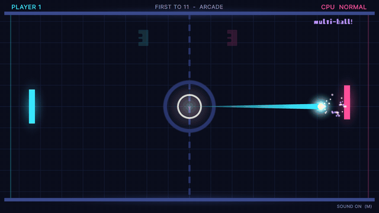
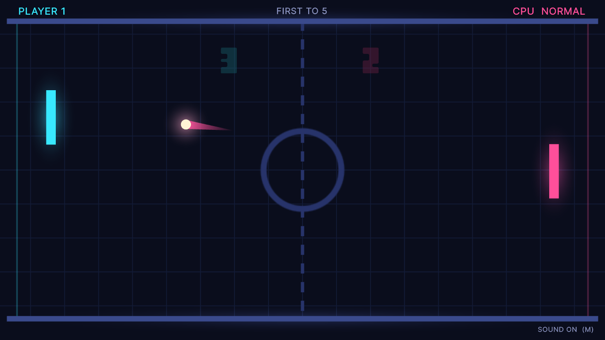
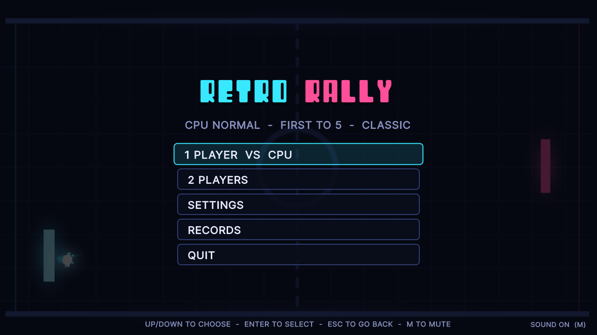
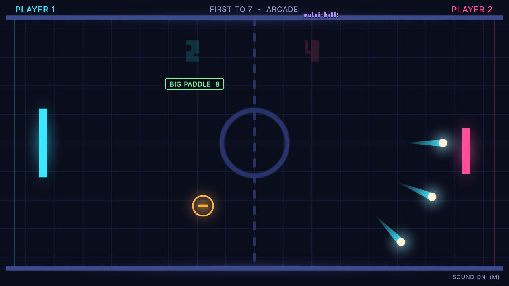
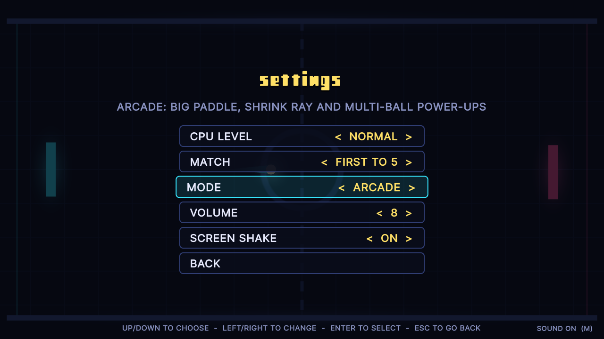
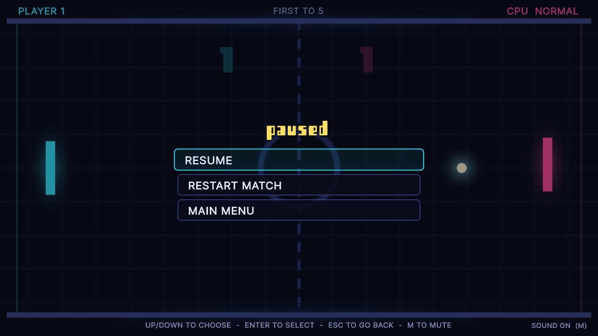
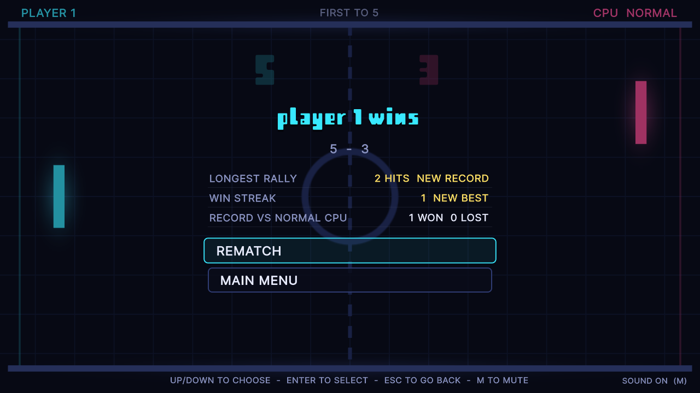

# Retro Rally

A neon arcade take on table tennis built with Unity: play a beatable CPU on three difficulty
levels or a friend on the same keyboard, first to 3, 5, 7 or 11, in Classic mode or in Arcade
mode with power-ups.





| | |
|---|---|
|  |  |
|  |  |
|  | |

## Play it

- **In your browser:** [trysac.github.io/Unity-Basic-PingPong-Game](https://trysac.github.io/Unity-Basic-PingPong-Game/)
- **On itch.io:** [trysac.itch.io/retro-rally](https://trysac.itch.io/retro-rally)
- **Get the code:** fork this repository, or clone it:

  ```bash
  git clone https://github.com/Trysac/Unity-Basic-PingPong-Game.git
  ```

## Run it

1. Install **Unity 6000.3.27f1 (Unity 6 LTS)** with Unity Hub (add the Windows or Web build
   support module if you want to build players).
2. In Unity Hub choose **Add → Add project from disk** and select the repository folder.
3. Open `Assets/Scenes/Main.unity` and press **Play**.

To build a player use **File → Build Profiles** (Windows or Web), or build from a terminal into
a folder outside the repository:

```bash
Unity -batchmode -quit -projectPath . -executeMethod RetroRally.EditorTools.ProjectBuilder.BuildWebGL -buildOutput ../build/web
```

(`BuildWindows` works the same way.) The WebGL build is uncompressed, so it runs from any
static host such as GitHub Pages.

The tests run from **Window → General → Test Runner** (EditMode and PlayMode), or from a terminal:

```bash
Unity -batchmode -projectPath . -runTests -testPlatform EditMode -testResults results.xml
Unity -batchmode -projectPath . -runTests -testPlatform PlayMode -testResults playmode.xml
```

The scene, materials, font atlas, icon and player settings are generated by
**Retro Rally → Regenerate Art, Scene and Player Settings** (`ProjectBuilder.SetUpProject`), and
the sounds by `python tools/audio/build.py` (needs ffmpeg). The README screenshots come from an
opt-in hook: run a built player with `-screenshot <folder>` (optionally
`-scenario title,rally,arcade,pause,gameover,settings`), or, without a player,
`Unity -batchmode -projectPath . -executeMethod RetroRally.EditorTools.ProjectBuilder.CaptureScreenshots -screenshot <folder>`.

## Controls

| Action | Player 1 | Player 2 (two-player mode) |
|---|---|---|
| Move the paddle | W / S (against the CPU also ↑ / ↓), or the last-used gamepad's left stick or d-pad (in 2P, the first gamepad) | ↑ / ↓, or the second gamepad |
| Serve (move while serving to angle it) | Space (against the CPU also Enter), or A | Enter, or A on the second gamepad |
| Pause | Esc or P, or Start | Esc or P, or Start |
| Menus | ↑ / ↓ to choose, ← / → to change a setting, Enter or Space to select, Esc to go back; the mouse and the d-pad work too | |
| Mute | M | |

## How it plays

- **Rallies.** Where the ball meets the paddle sets its angle: the centre returns it flat, the
  tips send it off at up to 55°. Every return makes it 0.45 units/s faster, from 8.5 up to 18.
- **Serves.** The ball waits on the server's paddle; the side that lost the point serves next.
  Moving while serving angles the serve; a server who waits 3 seconds is served for.
- **The CPU** picks the ball that will reach its goal first, works out the bounces, and steers
  there. Easy reacts every 0.3 s at half paddle speed and misjudges by up to 1.6 units; Normal
  reacts every 0.18 s at 70%; Hard every 0.08 s at 95%, aiming off-centre to angle its returns.
  Its misjudgement grows with the ball's speed, so fast, steep shots beat every level.
- **Arcade mode** drops a power-up on the court every 5 to 9 seconds; the ball collects it for
  whoever touched it last. **Big paddle** makes your paddle 1.5× taller and **shrink ray** makes
  the opponent's 0.6× for 9 seconds; **multi-ball** splits the ball into three, and the first
  of them to score ends the rally.
- **Records** on the device (PlayerPrefs): wins and losses against each CPU level, the current
  and best winning streak against the CPU, and the longest rally in any mode. The settings,
  volume, screen shake and mute are saved too.

## What I learned / technically interesting

- **Rules without the engine.** Ball flight, bounces, serves, scoring, the CPU, power-ups,
  settings and records live in `Assets/Scripts/Core`, a plain C# assembly with no Unity
  references, covered by 57 deterministic EditMode tests (a seeded xorshift generator keeps the
  CPU repeatable). 8 PlayMode tests drive the real scene: title, start, serve, score, win,
  pause, restart, main menu and settings.
- **Frame-rate independence, found with a test.** The 2021 version set the ball's velocity to
  `speed * Time.deltaTime` once, so a serve flew at 16.7 units/s at 30 fps and 4.2 units/s at
  120 fps. A PlayMode test on the original scene reproduced it before the fix; the core now
  moves everything in units per second, in sub-steps shorter than the ball so a fast ball cannot
  tunnel through a paddle.
- **A beatable CPU.** Instead of snapping to the ball, the CPU reacts late, moves at a capped
  speed and misjudges where a shot will land. A simulated duel against a scripted sharp player
  checks in a test that harder levels lose fewer rallies and that Hard still loses some.
- **Game feel.** Hit-stop scaled by ball speed, trauma-based screen shake and a kick towards
  each hit, paddle squash and flash, trails in the hitter's colour, goal-line flashes, score
  pops, banners and particle bursts, all on the game's own clock so pause and hit-stop never
  touch `Time.timeScale`.
- **Everything is generated.** Sprites are drawn in code at start-up; materials, the font atlas,
  the scene, the app icon and the player settings come from an editor script
  (`ProjectBuilder.cs`); the music and sound effects come from a tiny Python synthesizer
  (`tools/audio`). The UI is UI Toolkit and input goes through the Input System, so keyboard,
  mouse and up to two gamepads work.
- **Rescuing old work.** This started in 2021 as an "Intro to Unity" exercise in Unity 2020.1:
  three uGUI scenes, a player paddle, a paddle that followed the ball and a match to 5 points
  ([screenshots of the original](docs/original/)). It was upgraded to Unity 6, its logic was
  extracted and tested, and the idea was grown into a complete game.

## Credits

The **Retro** font is the FontStruction “Retro” by “andrejotha”
(<http://fontstruct.com/fontstructions/show/645057>), licensed under
[CC BY-ND 3.0](http://creativecommons.org/licenses/by-nd/3.0/); it ships unmodified in
`Assets/Fonts`. Everything else was made for this project. See [CREDITS.md](CREDITS.md).

## License

The code and the generated assets are under the [MIT License](LICENSE). The Retro font keeps its
own CC BY-ND 3.0 licence (`Assets/Fonts/License.txt`).
